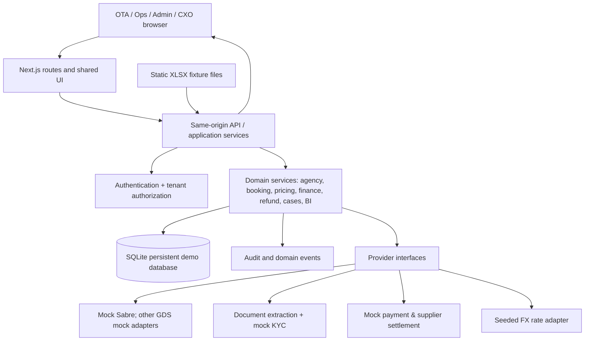

# HUBFARES — Technical Design & Engineering Contracts

> **Document ID:** HF-TD-002  
> **Version:** 1.1.1 · post-audit corrected technical companion to approved PRD v1.1  
> **Project:** One-day, interactive B2B travel-platform capability POC  
> **Product authority:** [`01_PRODUCT_SPEC.md`](01_PRODUCT_SPEC.md)  
> **Fixture authority:** [`03_DEMO_DATA_AND_MOCKS.md`](03_DEMO_DATA_AND_MOCKS.md)  
> **Test authority:** [`04_BUILD_TEST_DEMO.md`](04_BUILD_TEST_DEMO.md)  
> **Implementation status:** Design contract; not a claim that application code exists.

## 0. Read this first: authority, boundaries and terminology

This file defines **how** to implement the approved product. It may choose engineering mechanisms where the product specification leaves implementation freedom; it **must not change product scope**. Follow `01_PRODUCT_SPEC.md` for what users can do, role restrictions, features, screen IDs, workflows `WF-01` through `WF-23`, and acceptance checks `AC-001` through `AC-025`. The two explicit POC clarifications in Product Spec §13.1 (two-leg return; booked refund-policy snapshot) have been reconciled across the package; **other** material conflicts must be reported and the affected implementation stopped, never silently reconciled. The approved DOCX in `references/` remains the sign-off baseline.

**Three implementation depths:** `F` = stateful, testable behavior; `G` = guided/sample outcome; `R` = labeled roadmap preview. An `F` workflow may use a **deterministic mock external adapter**, but its **internal state changes are real**. Never imply an actual GDS, airline, bank, Aadhaar/PAN authority, supplier or FX service was contacted.

**Non-negotiable invariants:**

1. Hubfares is **B2B only**; an OTA is a separate tenant. No direct B2C booking site.
2. **Sabre-first mock**; Travelport/Amadeus are adapter-compatible placeholders. No live credentials or ticket issuance.
3. **OTA downstream markup is a saved UI configuration only:** never pass it into fare calculation, tickets, wallet, refunds or management profitability.
4. **Advanced commercial expression builder is guided only:** `BF`, `TF` and inclusion/exclusion expressions are **never executed**. Only a small **Hubfares-to-OTA core commercial rule** affects **new** quotes.
5. **INR/USD/EUR conversion is display-only**; original accounting, market/POS, booking and settlement currency stay unchanged. No real FX API is presumed available.
6. **Exactly two static fare-rule profiles** (`A_FLEXIBLE`, `B_RESTRICTED`); the booking stores its selected profile/fee snapshot and cancellation uses that same snapshot.
7. **Six genuine XLSX sample extracts (~100 rows per report) are static** and tenant-scoped; they **do not update** after a live demo booking. The passbook and CXO dashboard **do update** from shared records.
8. **Chatbot is OTA-only and scripted.** It may create a support case; **chat alone must not cancel a flight or move money**.
9. **Document text extraction is distinct from mocked identity verification**; a green verification tick requires an explicit simulated verification action/result.
10. Demo state must persist between page reloads and be resettable, with deterministic fixtures, safe idempotency and agency isolation.

Use feature-specific `F/G/R` behavior from the product spec; where no final production rule exists, implement only the stated demo rule and label it illustrative. No new integrations, ancillary features, free-form chatbot or production compliance claims without authorization.

---

## 1. Architecture decision

### 1.1 Chosen implementation pattern

**Modular monolith**: one responsive web application, same-origin server API, one relational demo database, domain-level services, and dependency-injected mock provider adapters. This minimizes setup and demo failures while keeping future providers replaceable.



**Do not use** microservices, event brokers, real external-payment flows, live airline endpoints or a distributed cache for the one-day POC. The interfaces and transaction events keep those additions possible later.

### 1.2 Concrete, deliberately conservative stack

| Concern | POC choice | Boundary / reason |
|---|---|---|
| UI & server | Next.js App Router, React, TypeScript (strict) | Single project, server-side API and role-aware routing. |
| Component styling | Tailwind CSS + reusable accessible primitives | Premium responsive UI; independently branded, TripJack-inspired layout only. |
| Validation | Zod on API input and application form boundaries | No reliance on client-only validation. |
| Database | File-backed SQLite, Drizzle ORM + `better-sqlite3` | Durable local demo with atomic write transactions and typed queries. |
| Charts | Recharts or compatible React chart library | Derived CXO metrics, not standalone fake charts. |
| XLSX | ExcelJS | Generate genuine static XLSX fixtures and scoped exports. |
| Documents | PDF text extraction for supported samples, OCR for selected PNG/JPEG images | Controlled real extraction; explicit failure/low-confidence review. |
| Mock providers | Typed TypeScript adapters backed by fixtures | No secrets or external dependencies. |
| Testing | Vitest for unit/integration; Playwright for critical UI/E2E | Repeatable transaction and tenant-isolation checks. |
| Package runtime | Node.js supported LTS; package-lock with pinned working dependency versions | Avoid version drift during handoff. |
| Deployment target | **Local demo on a persistent machine first** | SQLite must be on durable writable disk; ephemeral serverless storage is unsupported. |

**Version-pinning rule:** The implementing agent selects versions available in its environment, checks compatibility, then locks versions and records them in `package.json`/lockfile. Do not substitute a new UI, backend, ORM or database without recording an explicit technical deviation. Tailwind/UI packages are selected once and reused consistently.

**Cloud option:** If a public demo is needed, use a persistent Node server/volume or migrate the DB adapter to hosted PostgreSQL. Never deploy file-backed SQLite to an ephemeral serverless filesystem and claim persistent demo state.

### 1.3 Deployment modes

- `DEMO_MODE=mock` — default; **all external providers simulated**, strict deterministic behavior.
- `DEMO_AUTH_MODE=seeded` — controlled demo accounts; roles are validated server-side. Public role selector may exist for a trusted internal demonstration but does not create Hubfares/OTA permissions from untrusted parameters.
- `DEMO_CLOCK_MODE=system|fixed` — system clock for ordinary use; fixed deterministic clock for reproducible time-band tests. Flight departure instants must be compatible with demonstration date.
- `DEMO_RESET_ENABLED=true` — restricted seed reset; never exposed as a public unauthenticated endpoint.

### 1.4 Engineering-quality priority

First make the core path correct: **agency approval → wallet/credit → search → fare profile → booking/PNR/ticket → cancellation/refund → passbook/Ops/CXO**. Then add controlled PNR import, contextual chatbot cases, FX display, OTA markup UI and guided capabilities. The UI must remain navigable across the entire agreed scope, but complex guided capabilities must not consume core-transaction engineering time.

---

## 2. Source code organization and module contracts

```text
hubfares-poc/
  README.md
  AGENTS.md
  docs/
    01_PRODUCT_SPEC.md
    02_TECHNICAL_DESIGN.md
    03_DEMO_DATA_AND_MOCKS.md
    04_BUILD_TEST_DEMO.md
  references/
    Approved_PRD_v1.1.docx
    screenshots/
  fixtures/
    agencies.json
    users.json
    flights.json
    fare-rules.json
    core-commercial-rules.json
    downstream-markup-ui.json
    bookings.json
    payments.json
    refunds.json
    fx-rates.json
    import-pnrs.json
    chatbot-scenarios.json
    documents/
    reports/             # six real pre-generated XLSX report types
  src/
    app/
      (public)/
      (agency)/
      (operations)/
      (admin)/
      (executive)/
      api/v1/
    components/
      ui/                 # buttons, tables, forms, date/number inputs, drawers
      shell/              # role-aware layout, demo badge, navigation
      flight/             # search, brands, fare-rule panels
      finance/            # balances, passbook, refund quote
      support/            # scripted chatbot
      analytics/          # metric cards, charts, drilldowns
    features/
      onboarding/
      identity/
      agency-users/
      search/
      fares/
      booking/
      pnr-import/
      wallet-credit/
      payments/
      refunds/
      commercials/
      support-cases/
      executive/
      reports/
      guided/
    server/
      auth/
      db/                 # connection, schema, migrations, seed/reset
      providers/
        gds/
        identity/
        payments/
        supplier/
        fx/
      events/
      observability/
    shared/
      contracts/          # Zod schemas and shared DTO types
      money/
      time/
      errors/
  scripts/
    seed.ts
    reset-demo.ts
    validate-fixtures.ts
    build-xlsx.ts
  tests/
    unit/
    integration/
    e2e/
  .env.example
  package.json
  package-lock.json
```

**Rule:** `app/` and components do not directly query SQLite or mutate ledgers. Components call typed feature client functions/API endpoints. Business decisions live in pure functions/domain services; adapters have no access to UI components. Database access is server-only. Shared DTOs must not leak sensitive fields.

### 2.1 Domain ownership

| Module | Owns | May call/read | Must never own |
|---|---|---|---|
| Identity / tenancy | Session, role, agency scope, permission checks | User/agency records | Business policy calculations |
| Onboarding | Registration, documents, extraction status, application review | Mock KYC, agency activation | Real authority verification |
| Agency users | Users/permissions under agency | Identity | Other agencies' accounts |
| Search/Fares | Seeded offers, filters, fare brands/profile, display conversion | GDS mock, commercial core | Wallet entries |
| Booking | Revalidation, PNR, ticket, hold/commit lifecycle | Fares, funding reservations, mock GDS | Direct external airline calls |
| Wallet/Credit | Ledger, funding holds, credit eligibility/entries | Agency policy, payment match | Commercial rule authoring |
| Payments | Received/mock bank events, matching, duplicate handling | Wallet credit service | Unverified banking claims |
| Refunds | Quote, cancel/void, refund policy snapshot, payout status | Booking, funding/ledger, supplier mock | OTA chatbot case as money action |
| Commercials | Executable **core** Hubfares price policy; UI-only OTA markup/advanced builder | Agency, search context | Advanced expression evaluation |
| Support | Chat session/intent, support cases, operations handoff | Authorized booking/refund read | Airline change or wallet movements |
| Executive BI | Aggregate and drill-down read models | Booking, finance, agency, ops | Second independent transaction store |
| Reports | Authorized static XLSX fixture selection | Session agency scope | Live generated reporting claims |
| Guided | Demo amendment/manual/supplier workflows and roadmap previews | Seed state, optional support case | Production integrations |

### 2.2 No hidden scope expansion

- Multi-city appears in **Agency Markup UI** and roadmap, not a working multi-city booking engine.
- `AGENCY_ADMIN` markup editing does not change quote pricing. This rule should be technically enforced by **not importing the markup repository into the pricing service**.
- `BF/TF` expression strings are plain draft text; no `eval`, dynamic JavaScript execution, SQL injection of expressions, or implicit pricing action.
- Executive/Operations open-ended AI copilots are **roadmap**. Only the OTA finite-state support chatbot is required.
- Sample XLSX reports do not query live booking events. They are pre-generated snapshots.

---

## 3. Persistence model and relational schema

### 3.1 Storage rules

1. Store IDs as stable opaque strings (`agency_...`, `book_...`, `case_...`), internally backed by UUID/ULID or deterministic seeded IDs; external PNRs and ticket numbers are **separate fields**, not primary keys.
2. Persist all `F` records in SQLite. Guided drafts may be persisted when cross-screen linkage is required; roadmap items do not need live service tables.
3. **Monetary values:** integer **minor units** (`*_minor`, e.g., 1250000 = INR 12,500.00), with ISO-4217 `currency`. Never calculate cash with JavaScript floating-point decimals.
4. Core POC charge/settlement currency = **INR** for seeded bookings and ledgers; other currencies are display equivalents only. FX rates are rational/decimal fixture values, not independent booking money.
5. Store UTC timestamps in ISO-8601 or database millisecond form; also store the origin/destination IANA zones where known for display. Use UTC instants for fare-rule time bands.
6. Use foreign keys, `NOT NULL` for agency-owned data, appropriate unique constraints and indexes; enable SQLite foreign-key enforcement and WAL mode.
7. Financial and audit entries are **append-only**. Correct by compensating entry, never by editing a posted amount.
8. Scope every customer-owned query by `agency_id` **from authenticated session/authorization**, not by the browser's requested agency ID.

### 3.2 Canonical tables

Primary keys are `id` unless stated. `agency_id` means required tenant ownership except for a global/reference record. `created_at`, `updated_at` and `version` exist where edits/state updates occur. Exact Drizzle migrations must implement the following contracts without adding unsupported business behavior.

| Table | Mandatory/important columns | Constraints and relationships |
|---|---|---|
| `agencies` | `id`, `legal_name`, `display_name`, `status`, `registered_at`, `activated_at`, `country` | Unique demo legal/ref identifier; status controls booking permission. |
| `users` | `id`, `agency_id?`, name, email, role, status, password_hash/demo credential reference | Agency roles require agency_id; Hubfares roles do not; normalized unique email. |
| `user_permissions` | user_id, permission_key, allowed | Unique `(user_id, permission_key)`; only admin-authorized editing. |
| `sessions` | id, user_id, expires_at, revoked_at, session_hash | Server session, HTTP-only cookie; no localStorage bearer token. |
| `registration_applications` | id, agency_draft_json, email, status, submit_time, reviewer_id, decision_time | Creates an agency only on approval; application ID distinct from agency ID. |
| `uploaded_documents` | id, application_id, type, storage_reference, mimetype, size_bytes, extraction_status | No real document IDs stored in demo logs; sanitize filename. |
| `document_extractions` | id, document_id, fields_json, confidences_json, extraction_engine, reviewed_fields_json | Extraction result distinct from verification result. |
| `kyc_checks` | id, application_id, document_id?, check_type, mock_result, checked_at, actor_id | `SIMULATED` source; green tick only on mock verified. |
| `agency_policies` | id, agency_id, type, effective_from, effective_until?, version, enabled, config_json | `CREDIT`, `REFUND`, etc.; **booking freezes the effective REFUND policy id/version/mode at creation**; claims copy that booking snapshot; new policy applies only to bookings created after effective_from. No retroactive mutation. |
| `agency_markup_ui_rules` | id, agency_id, journey, trip_type, airline_filter, cabin_filter, markup_kind, value, currency?, enabled | **UI-only**; no relation to booking quote or ledger. |
| `core_commercial_rules` | `id`, agency_id?, airline_code?, origin?, destination?, `fixed_fee_minor`, `percent_bps`, `disclosed_service_fee_minor`, `percentage_base`, `rebate_minor`, `priority`, `enabled`, `effective_from`, `effective_until?`, `rule_version` | **Only** executable simplified Hubfares rules. Nonnegative integer minor/bps fields; `percentage_base='SUPPLIER_BASE'` only; rebate accrual tracked separately, zero in baseline; no BF/TF. All components represented **in one selected rule**. |
| `advanced_commercial_drafts` | id, rule_name, criteria_json, expression_lines_json, priority, enabled, draft_revision | Guided preview/history; never referenced by pricing service. |
| `providers` | id, provider_code, provider_kind, status, mode | Sabre mock active; Travelport/Amadeus mock/roadmap; no key. |
| `suppliers` | id, name, demo_code, status | Supplier-level association. |
| `pcc_mappings` | id, provider_id, pcc_code, agency_id?, enabled, description | Import/lookup permission; no real GDS PCC assertion. |
| `flight_offers` | id, provider_code, airline, operating_carrier, flight_number, route, `departure_at`, arrival_at, time_zones, cabin, stops, availability | Synthetic offers; deterministic IDs for search. |
| `fare_brands` | id, offer_id, brand_code, sell_basis_minor, supplier_base_minor, supplier_tax_minor, refundable_label, baggage_json, rule_profile_id | Multiple brands per flight; all minor units INR. |
| `fare_rule_profiles` | id (`A_FLEXIBLE`/`B_RESTRICTED`), slabs_json, no_show_json, seat_fee_json, version | **Exactly 2** rows; fixture defines exact values from Product Spec §5.3. |
| `quotes` | id, agency_id, user_id, `trip_type`, `segment_count`, `supplier_cost_minor`, `sell_amount_minor`, `currency`, `expires_at`, `snapshot_json`, `status` | One quote **per itinerary**, `segment_count=1` one-way / `2` return; aggregate totals derived from ordered quote segments. Never use single `offer_id` to represent a two-leg quote. |
| `quote_segments` | id, quote_id, `leg_index`, `direction`, offer_id, brand_id, fare_rule_profile_id, profile_version, `core_rule_id`, `core_rule_version`, `supplier_base_minor`, `supplier_tax_minor`, `fixed_fee_minor`, `percent_fee_minor`, `disclosed_service_fee_minor`, `rebate_minor`, `leg_sell_minor`, `leg_supplier_cost_minor`, `departure_at`, `arrival_at`, `snapshot_json` | Ordered legs, `leg_index 0..n-1`, unique `(quote_id,leg_index)`, each price derived from **its** selected rule and brand; consistent traveler count and itinerary connection. |
| `bookings` | id, agency_id, quote_id?, user_id, source, provider, pcc?, `trip_type`, `segment_count`, booking_status, ticket_status, booked_at, `first_departure_at`, sell_amount_minor, supplier_cost_minor, `refund_policy_id`, `refund_policy_version`, `refund_payout_mode`, booking_snapshot_json | Source `PORTAL/IMPORTED/MANUAL_DEMO`; one booking per itinerary; immutable monetary/policy snapshot; no ticket before issuance. Imported booking gets explicit demo policy snapshot at **import** time if original terms unavailable. |
| `booking_segments` | id, booking_id, `leg_index`, direction, flight_offer_id?, airline, flight_number, origin, destination, departure_at, arrival_at, cabin, fare_brand_id?, `fare_rule_profile_id`, `profile_version`, `fare_rule_snapshot_json`, `segment_sell_minor`, `segment_supplier_cost_minor` | One or two ordered booked legs, full itinerary snapshot; unique `(booking_id,leg_index)`. Partial-leg cancellation is deferred. |
| `passengers` | id, booking_id, display_name, traveler_type, masked_doc_reference? | Synthetic only; no real government identity number. |
| `pnr_records` | id, booking_id, provider, pcc, gds_pnr, airline_pnr?, imported | Unique provider/PCC/PNR where applicable; scope through booking. |
| `tickets` | id, booking_id, passenger_id?, ticket_number, issued_at, status | Unique ticket number; created only by a successful TICKETED transition, **may remain historically linked after CANCELLED or VOIDED**; for one synthetic adult on two-leg return one ticket may cover both segments. |
| `funding_reservations` | id, agency_id, booking_id?, wallet_hold_minor, credit_hold_minor, status, expires_at | `ACTIVE/CONSUMED/RELEASED`; atomic availability calculation. |
| `wallet_ledger_entries` | id, agency_id, type, direction, amount_minor, currency, external_ref?, booking_id?, refund_id?, idempotency_key, created_at | Append-only; unique `(agency_id, idempotency_key)`; cash balance from SUM. |
| `credit_ledger_entries` | id, agency_id, type, direction, amount_minor, booking_id?, due_at?, idempotency_key, created_at | Append-only credit draw/repayment; unique idempotency, outstanding derived. |
| `payment_events` | id, agency_id?, external_payment_ref, gross_amount_minor, currency, status, received_at, matching_json | Unique external payment ref + provider; credited only when confirmed match. |
| `payment_matches` | id, payment_event_id, agency_id, status, matched_at, matched_by, ledger_entry_id? | One successful match → one wallet ledger entry. |
| `cancellations` | id, booking_id, agency_id, quote_snapshot_json, `segment_slab_breakdown_json`, estimated_refund_minor, status, idempotency_key, requested_at | **One full-itinerary** cancellation per booking in Phase 0; two-leg breakdown where relevant, no partial portion. |
| `refund_claims` | id, booking_id, agency_id, `refund_policy_id`, `refund_policy_version`, `payout_mode`, `agency_refund_minor`, `supplier_expected_minor`, `supplier_received_minor`, `agency_payout_status`, `supplier_status`, `idempotency_key`, `status` | One claim per confirmed cancellation; booking-time policy copied, one payout credit max, independently tracked supplier receipt; no mutable backdating. |
| `supplier_settlement_events` | id, refund_id, supplier_id, external_ref, amount_minor, status, received_at | Simulated statement/receipt; unique `(supplier_id, external_ref)`; replay is idempotent; must **not** automatically post wallet credit. |
| `support_conversations` | id, agency_id, user_id, locale, menu_state, selected_booking_id?, draft_payload_json, updated_at | Scripted finite-state session, no LLM transcript required. |
| `support_cases` | id, agency_id, user_id, booking_id?, source, category, summary, status, assigned_to?, priority, created_at | Exact case ID exposed to OTA and Ops; no monetary side effect. |
| `case_events` | id, case_id, actor_id, action, from_status?, to_status?, note?, created_at | Status/assignment history. |
| `amendment_cases` | id, agency_id, booking_id, type, status, quote_json | Guided-only workflow. |
| `notifications` | id, agency_id?, user_id?, kind, reference_id, payload_json, seen_at? | In-app/demo; real messaging deferred. |
| `audit_events` | id, actor_id, actor_role, agency_id?, action, entity_type, entity_id, metadata_json, occurred_at | No sensitive raw data; append-only. |
| `domain_events` | id, type, entity_type, entity_id, agency_id?, payload_json, occurred_at, processed_at? | Commit with state mutation; optional local projection/replay. |
| `fx_demo_rates` | id, base_currency, quote_currency, numerator/decimal_rate, effective_date, source | INR base, USD/EUR equivalents; one rate version per demo scenario. |
| `demo_metadata` | key, value | Seed version, reset counter, clock/rate policy. |

**Schema notes:** Business names and `agency_id` appear on many tables to make authorization and joins explicit. `wallet_ledger_entries` and `credit_ledger_entries` must never be edited after posting. Where an imported PNR has no fresh ticketing or supplier settlement, populate only fields known in the deterministic fixture. For accounts derived from the pending agency, use an initial application row first, then activate/create agency and its administrator transactionally.

### 3.3 Required indexes and uniqueness

- `agencies(status)`; `users(agency_id, role, status)`; `registration_applications(status, submit_time)`.
- `bookings(agency_id, booked_at)`, `(agency_id, booking_status)`, `(agency_id, provider)`; `quote_segments(quote_id, leg_index)` and `booking_segments(booking_id,leg_index)` unique; enforce each round trip has **exactly two** legs at quote/booking service boundary (DB constraints/triggers if practical). `pnr_records(provider,pcc,gds_pnr)` unique for imported records.
- `wallet_ledger_entries(agency_id, created_at)` and unique `(agency_id, idempotency_key)`; same for credit ledger.
- `payment_events(provider_code, external_payment_ref)` unique; one `payment_matches` success/credit per event.
- `refund_claims(agency_id, payout_status, created_at)`; `support_cases(agency_id, status, created_at)`; `audit_events(entity_type, entity_id, occurred_at)`.
- Make all foreign-key delete behavior explicit: protect bookings and posted ledger entries from cascading deletion. Prefer logical disable/status changes.

### 3.4 Data scope and seed/reset semantics

The seed script establishes immutable reference fixtures, stateful demo records, and a demo clock/rate version. Use **one canonical seed set** to produce bookings, refunds, ledger, dashboard measures and support lookups; do not separately hardcode independent totals in components. Reset is **atomic and authorization-gated**: close active demo sessions as appropriate, truncate/replace demo rows in safe FK order (or replace a dedicated demo SQLite file), reapply seeds and regenerate deterministic IDs. Never reset a real database with `DEMO_MODE != mock`.

---

## 4. Business transactions and deterministic calculations

### 4.1 Money, percentages and date treatment

- Default **transaction currency = INR** in the one-day seeded flows; store paise as integers. UI formatting uses `Intl.NumberFormat('en-IN', {style:'currency', currency:'INR'})` or localized equivalent.
- Percent rules stored as basis points (`100 bps = 1%`) and applied with integer arithmetic: `roundHalfUp(baseMinor * basisPoints / 10_000)`; exact rounding at calculation boundary, **once**.
- Addition/subtraction done in minor units. Use an explicit `Money` type `{amountMinor: integer, currency: 'INR'}` and reject mismatched currencies in domain operations.
- All timestamps as UTC instants, and local flight time rendered with airport IANA zone. Date-only UI inputs need clear timezone conversion; API accepts ISO-8601 with timezone when creating scheduled instants.
- Fare-rule lookups use the **stored departure instant of each booked segment** and the **server clock** (fixed test clock available). A leg already departed takes its no-show/not-eligible treatment even if another leg has not departed.

### 4.2 Fare-rule boundaries — exact specification

For `remainingTime = segmentDepartureUTC - nowUTC` (in milliseconds), **per booked itinerary segment**:

| Condition | Applicable slab | Display |
|---|---|---|
| `segmentDepartureUTC <= nowUTC` | No-show / post-departure policy, separately | `After departure` |
| `0 < remainingTime < 2 hours` | `S0` | `Less than 2 hours` |
| `2 hours <= remainingTime < 24 hours` | `S1` | `2–24 hours` |
| `remainingTime >= 24 hours` | `S2` | `24 hours or more` |

**Implementation:** Compare millisecond instants, **not rounded-down minutes**, for slab selection. Exactly 2h belongs to `S1`; exactly 24h belongs to `S2`; exactly departure belongs to no-show. For one-way, one segment is evaluated. For return **full-itinerary** cancellation, calculate fees independently for outbound and inbound using each segment's departure/profile and add once into one refund quote; no partial-leg cancel action. The two approved profile values are defined only in Product Spec §5.3 / fixture `fare-rules.json` and must not be retyped differently in source files.

### 4.3 Simplified Hubfares-to-OTA pricing engine — functional

**Allowed inputs:** active agency, airline code, optional route pair, eligible supplier base amount, fixed markup/service fee, percentage commission/rebate, effective date, priority. **Prohibited inputs:** OTA markup UI rule and advanced commercial expression drafts.

1. Find enabled/existing rules effective at quote creation time.
2. Choose **one** rule in this deterministic order: exact `agency+airline+route` → `agency+airline` → `agency+route` → `agency default` → `global airline/route` → `global default`. Within the same specificity, `priority` descending, then latest `effective_from`, then lexicographically smallest stable rule ID. Display selected rule ID/rationale. An unsupported combination simply falls back; no merged expression evaluator.
3. For **each quote segment**, calculate billed agency leg amount from its seed fare **supplier component breakdown** and the selected commercial rule: `supplierBase + supplierTax + fixedFee + percentFee + disclosedServiceFee`. For a return journey add the **two independently priced legs** to form one quote total (each fixed fee applies **once per leg**, not per booking). Clamp/validate against negative; show components. Define the `percentFee` calculation base as `supplierBase` only for Phase 0 (not taxes). **Agency rebate/commission is a separately accrued contractual expense**, not subtracted from the billed sell amount here; the executive net-platform-revenue calculation subtracts it **once**. If seed fixtures represent an upfront discounted agency price instead, mark the rebate as already netted and do not subtract it again. The fixture must choose and label one treatment consistently.
4. Save one itinerary quote plus one/two ordered `quote_segments`: each source offer/brand/profile, supplier and agency leg totals, applied core rule ID/version, detailed fee components, created/expires timestamps; the quote aggregate equals the sum of the legs. Freeze the currently effective agency refund-payout-policy ID/version/mode **when a booking is created**, not when a quote is displayed.
5. A new core-rule update changes **future quotes only**. Existing accepted quotes/bookings retain their original snapshot; if a quote expires, revalidate/re-quote and request acceptance if price changes.

**Separation test:** Edit an OTA markup rule or advanced-rule `BF/TF` text; quote amount must remain byte-for-byte unchanged. Edit an executable core Hubfares rule; the next matching quote must change while the old booked amount stays fixed.

### 4.4 Quote revalidation and booking/ticketing

```mermaid
sequenceDiagram
  participant OTA as OTA user
  participant API as Booking service
  participant GDS as Mock GDS adapter
  participant FIN as Funding service
  participant DB as SQLite
  OTA->>API: Revalidate quote
  API->>GDS: revalidateFare(offer, brand)
  GDS-->>API: Same / Changed / Unavailable
  API-->>OTA: Revised quote and accept-price gate if changed
  OTA->>API: Create booking (idempotency key)
  API->>DB: Transaction: validate agency + quote + limits
  API->>FIN: Reserve wallet/credit spending power
  API->>GDS: createBooking (mock PNR)
  GDS-->>API: PNR or failure
  API-->>OTA: Booking with PNR / failure
  OTA->>API: Issue simulated ticket (idempotency key)
  API->>GDS: issueTicket (mock)
  API->>DB: Transaction: ticket + consume reservation + ledger
  API-->>OTA: Ticket number; booking and finance updated
```

**Two-stage POC contract:**

- `POST /bookings`: validate confirmed revalidated **full itinerary** quote (one leg for one-way; **outbound and inbound both selected and revalidated** for round-trip), active agency, passenger fields, funding for the aggregate INR amount; create one `PNR_CREATED` booking, one/two immutable booking segments and one reservation atomically; snapshot the **effective REFUND policy** at booking time. Simulate one GDS PNR for the itinerary. Failure on either leg or provider step fails/rolls back the **entire** booking and releases reservation, no charge.
- `POST /bookings/{id}/issue-ticket`: only from PNR-created, active reservation; mock ticket issuance for the **complete itinerary**; if success, atomically set ticketed state, insert ticket(s) (a single adult may have one ticket reference covering two flight segments), append **one** wallet debit and/or credit draw for the aggregate booking amount, consume reservation, append domain/audit events; if failure, mark ticketing failed and release reservation (no net charge). A deliberate retry needs a new explicit attempt after validation, not a silent second issuance.
- `GET /bookings/{id}` returns separate `bookingStatus`, `ticketStatus`, GDS/airline PNR(s) and ticket number only when applicable.
- **Idempotency:** Same client action key returns the same booking/ticket result without duplicate PNR, ticket or funding entries. Provider simulated calls also use deterministic action keys.

This is **demo booking sequencing**, not a claim of how live Sabre order/ticket services behave. Real GDS lifecycle must be revalidated during Phase 1.

### 4.5 Wallet and credit funding logic

**Ledger definitions:**

- `walletCashMinor = SUM(wallet credits) − SUM(wallet debits)`, including explicit refunds and reversal/adjustment entries; initial balance comes from a seeded opening ledger event, never a standalone editable balance.
- `activeWalletHoldMinor = SUM(wallet_hold_minor for ACTIVE reservations)`.
- `availableWalletMinor = max(0, walletCashMinor − activeWalletHoldMinor)`.
- `creditOutstandingMinor = SUM(credit draw) − SUM(credit repayment/adjustments)`.
- `activeCreditHoldMinor = SUM(credit_hold_minor for ACTIVE reservations)`.
- `availableCreditMinor = max(0, creditLimitMinor − creditOutstandingMinor − activeCreditHoldMinor)` if agency credit eligible and not blocked/overdue; otherwise `0`.
- `spendingPowerMinor = availableWalletMinor + availableCreditMinor` (for validation only; do **not** call it wallet cash).

**Booking reservation allocation:** `walletHold = min(sellTotal, availableWallet)`, `creditHold = sellTotal − walletHold`; reject unless `creditHold <= availableCredit` and agency active. Create `ACTIVE` funding reservation in a database transaction. **At ticket issuance**, append a wallet DEBIT for walletHold, credit DRAW for creditHold and mark reservation CONSUMED in **the same transaction**. If booking fails, mark reservation RELEASED and append no charge. For scripted demonstrations without ticket failure, this gives clear passbook behavior.

**Credit terms:** Agency policy can be upfront, daily, weekly or custom (including 15 days). For demo due date, compute from ticket-issuance date in agency business time zone plus `termDays` (`0` for upfront, `1` for daily, `7` weekly, `15` selected custom), with same-time-of-day behavior; store `due_at`. A credit-limit change affects **available credit for new bookings**, never historical charges. Overdue credit blocks new credit draws when policy says `blockOnOverdue=true`; wallet booking may still be allowed if policy explicitly permits it. Agency liability vs wallet cash remain separate.

**Credit paydown:** Simulated credit repayment is a separate authorized credit ledger event; **do not automatically apply a wallet refund against credit outstanding**, because the agreed POC refund rule credits wallet. Present the two balances separately. A future production offset mechanism requires new product approval.

### 4.6 Payment matching — automated workflow simulation

1. Seed/mock payment event includes provider code, unique external reference, amount INR, transfer timestamp and agency hint/reference.
2. Matching service checks unique external reference, amount, recognized agency reference and accepted event status. Unmatched, wrong amount and ambiguous agency go to Operations queue and **do not credit wallet**.
3. On success, **one SQLite transaction** updates match/event state, appends one wallet CREDIT keyed `payment:{provider}:{externalRef}` and audit/domain events.
4. Duplicate webhook/event replay returns prior result (`DUPLICATE/ALREADY_PROCESSED`) without another ledger row.
5. Manual exception resolution by authorized Ops/Finance may create a single verified match; demonstration is still simulated. No real bank account or payment acknowledgement is sent.

### 4.7 Cancellation and refund — exact separation of liabilities

1. Require ticketed, eligible booking; take the **immutable original segment fare/price snapshots** plus **booking-time agency refund-payout-policy snapshot**, not currently searched fare or policy.
2. Derive departure-time slab from §4.2 for **every booked segment**, using its own departure/profile. Full-itinerary cancel only for one- or two-leg booking; mock void eligibility with a labeled fixture. If any action is ineligible, show reason instead of mutating.
3. Calculate `refundableComponentsMinor` as the sum of eligible booked segment components; `supplierPenaltyMinor` as the sum of the approved per-segment slab penalties; `serviceFeeMinor` as the sum of separately disclosed per-segment terms. `estimatedAgencyRefundMinor = clamp(refundableComponentsMinor − supplierPenaltyMinor − serviceFeeMinor, 0, agencyAmountPaidMinor)`. For `Non-refundable` slab, refund the defined eligible components only (Phase 0 seed may set this to zero); do not override general fare-brand labels.
4. Show itemized estimate, airline/supplier charge versus Hubfares fee, per-pax/per-sector applicability and a **confirm** step.
5. Commit booking cancellation/void, one cancellation record and **one claim per whole itinerary**, with **policy ID/version/mode taken from the booking snapshot**, segment fee breakdown and all immutable snapshots. Admin policy updates are prospective for new bookings only; the existing booking must use its original policy. Use unique cancellation request idempotency key and unique payout key.
6. **Supplier-settlement policy:** claim stays `PENDING_SUPPLIER`, supplier expected receivable tracked; no OTA wallet CREDIT before distinct simulated supplier receipt and approved payout event.
7. **Immediate-eligible policy:** once approved, append **one** wallet REFUND CREDIT; claim can simultaneously remain supplier `PENDING`. Never mark supplier funds received based solely on agency credit.
8. Supplier matching UI is **guided** but its triggered **mock settlement event is persisted**. `supplier-settlement-demo` records received amount and matched/exception state **without crediting the OTA wallet**. For an approved `SUPPLIER_SETTLEMENT` claim, **only after a full exact received/matched settlement**, an authorized `payout-demo` posts exactly one `REFUND_CREDIT` ledger entry and transitions agency payout to credited; duplicate payout/replay is idempotent. Partial/mismatched receipts remain exception/on-hold. An `IMMEDIATE_IF_ELIGIBLE` claim already paid does not receive a second credit after settlement.
9. Cancellation of already cancelled/voided booking or repeated payout submission is a no-op/error, **never a second credit**.

**Void vs cancellation:** Provider mock explicitly returns void eligibility. **Baseline `book_seed_004` is an authorized full void with no supplier penalty or service fee**, refunding the full agency INR 10,000 after a separate INR 9,000 mock supplier receipt; it is not priced using the B cancellation slab. Other void outcomes require an explicitly seeded rule, not invention. A void is not automatically identical to normal cancellation. No undisclosed fees.

### 4.7a Booking-time refund policy snapshot — mandatory

- When creating **either** portal booking or accepted imported-booking record, resolve exactly one enabled REFUND policy effective at `booked_at`/record creation, then **copy** its ID, version, payout mode and approval constraints into immutable booking snapshot columns. This is **independent of** live credit-policy checks.
- On cancellation/void, the claim **inherits** these frozen fields. Updating `ADM-04` creates a new effective version for **future booking creations** only. It must not alter existing bookings or claims; `GET /bookings/{id}` and refund quote expose the applied version.
- Do not implement a retroactive override in Phase 0. If it is required in production, it must be explicitly approved, authorized, audited and specified separately.
- **Supplier receipt workflow:** `supplier-settlement-demo` is guided UI with persisted **mock receipt evidence**; distinct `payout-demo` is a functional, authorization-gated idempotent financial action. A matched receipt does not itself credit the wallet. A settlement-based claim pays exactly once only when eligible and fully matched; immediate claims stay one-credit even after receipt.

### 4.8 Static Excel reports versus dynamic dashboards

- Produce six real `.xlsx` report types from **frozen** fixture rows (~100 each total) and store outputs under `fixtures/reports/` or a generated readonly folder.
- Each download request validates the authenticated role; Agency Admin/Agent receives a **server-generated agency-scoped export of the frozen sample rows**, or a pre-generated safe agency variant. Hubfares Ops/Admin **and read-only Hub CXO** receive authorized all-agency rows. The **same** report catalogue/export UI is reused under OTA, Ops and Executive navigation without additional report IDs or dynamic report sources. **Never** send an all-agency workbook and filter in browser.
- Every report includes `Sample extract`, a fixture snapshot timestamp and explicit row scope. A download does **not** recompute against live SQLite transactions and should not imply it does.
- Exec/CXO dashboard, OTA dashboards and passbook **do** query live joined/aggregated state from SQLite. Treat the two sources as different by design.

### 4.9 Display currency, not currency conversion for accounting

Seed `fx_demo_rates` must define **INR per unit of displayed currency** for `INR`, `USD`, `EUR` with one rate date and `DEMO` source. For a stored INR amount:

```
convertedMajor = (amountInrMinor / 100) / inrPerUnitOfDisplayCurrency
```

Use a decimal/rational library or stable integer scaling for this conversion and format display to two fraction digits; round **only at the display boundary**, not in ledger arithmetic. Retain base INR amount in UI detail and JSON response. The selected currency is ephemeral user preference/current booking journey state; it **must not** be copied into financial transaction currency, supplier settlement, agency credit or revenue measures. If a rate is missing, show INR original and `Demo conversion unavailable` (no guessed rate).

### 4.10 Executive financial calculations

Choose **booking-cohort basis** for the one-day demo: filter bookings by the original `booked_at` date inside the selected window; link their later cancellations/refunds to that booked cohort. UI must disclose `Date basis: booking date`. The same scope applies to agency rankings, contribution, sales and cancellations. For live dashboard illustration, amounts are aggregated in INR from immutable booking/financial records, not separately seeded KPI totals.

- `GBV` = sum original **ticketed** agency sell amounts for qualifying cohort (including subsequently cancelled tickets as gross sales), exclude failed/draft/imported-without-ticket-amount.
- `agencyRefunds` = eligible confirmed refunded/owed agency amounts for these booking IDs (avoid duplicate payout vs claim counting); show pending liability separately.
- `supplierRefunds` = supplier refunded/credited amounts recognized for the same bookings; show unrecovered expected as separate receivable, not received money.
- `retainedAgencySales` = GBV − agencyRefunds.
- `retainedSupplierCost` = initial supplier costs for qualified tickets − recognized supplier refunds/credits.
- `netPlatformRevenue` = retainedAgencySales − retainedSupplierCost − **separately accrued** agency rebates/commissions − external pass-through payments (each component booked once). If a rebate is already netted in a booked agency charge, its separate expense component is zero; never double-count it.
- `estimatedContribution` = netPlatformRevenue − modeled processing/variable operational expenses.
- `contributionMarginPct` = estimatedContribution / retainedAgencySales × 100, `N/A` on zero denominator.
- `ticketedCount` = distinct **historically successfully ticketed** booking IDs in cohort, including later cancelled/voided and eligible imported tickets. `cancellationRate` = distinct `CANCELLED` booking IDs **excluding `VOIDED`** / that ticketed cohort. `voidCount`/`voidRate` separately count originally ticketed `VOIDED` records using the same denominator. Unticketed PNRs/failed holds are excluded from both numerator and denominator. Show counts/date basis.
- `activeOTAs` = distinct agencies with qualified cohort transactions; `averageBookingValue` = GBV/ticketedCount when nonzero.
- `creditOutstanding` = sum outstanding agency credit ledger; `overdue` = outstanding due allocations with `due_at < now`.
- `OTARefundPending` = approved refund obligations not yet credited; `supplierReceivable` = expected supplier refunds less matched/recognized receipts, never negative.

**Important demo convention:** `agencyRefunds` for contribution is recognized when the eligible cancellation is confirmed (the agency obligation arises), whether the wallet is credited immediately or after supplier settlement. The **wallet ledger** reflects payout timing separately. Supplier refund expected is a receivable/exposure, not a recognized received credit until a mock settlement event is explicitly applied. This avoids changing profit just because refund payment was delayed. These are illustrative management metrics, not accounting policy for production. A seeded operations cost fixture supplies modeled variable costs; avoid duplication in reports.

---

## 5. API design and DTO contracts

### 5.1 API standards

- **Canonical API prefix = `/api/v1`** for **all** routes (read and mutation). Every inventory path below, e.g. `POST /auth/login`, is **relative to `/api/v1`** and must be served as `POST /api/v1/auth/login`. All frontend callers, documentation, test examples and error diagnostics use the prefixed absolute path. Use `POST`/`PATCH`, not GET side effects.
- Inputs validated using Zod; outputs typed. Currency amounts are `{amountMinor, currency}` or documented `*_minor` fields, never untyped strings.
- Server derives `userId`, `role`, `agencyId` from authenticated session. Privileged Hubfares routes may accept selected agency ID **after** checking permission; OTA routes **ignore/reject** attempts to cross tenant.
- `Idempotency-Key` required for financially consequential actions (`booking create`, `ticket issue`, `payment match`, `cancellation confirm`, `supplier settlement match`, `wallet payout`, `PNR import`, `chat case submit`). Store operation key, actor/agency, request fingerprint and result. Same key + same payload returns previous success; same key + different payload → `409 IDEMPOTENCY_CONFLICT`.
- Return structured errors: `{error:{code,message,details?,requestId}}`. No stack trace or real PAN/passenger data in client errors.
- Success envelope: `{data:{...},meta?:{demo:true,source:'SIMULATED'|'SEEDED'|'INTERNAL',requestId,...}}`. A `SIMULATED` label refers to external results, not to whether state is persisted.
- Pagination/filters on lists; server-authorized scope; API time values in ISO-8601 UTC; sorting stable with ID tie-breaker.
- Use `403` for unauthorized action, `404` for agency-inaccessible record (neutral), `409` for conflicting state/idempotency, `422` for invalid business input, `503` for deliberately unavailable mock scenario.

### 5.2 API route inventory

**Paths below are short form relative to `/api/v1`**: `/bookings/{id}` means `/api/v1/bookings/{id}`. Route files and client/test calls must implement the actual prefixed path, with no unprefixed shadow APIs. Product-screen IDs remain as in Product Spec §4.

| Method / endpoint | Purpose | Actor / guard | Core side effect |
|---|---|---|---|
| `POST /auth/login` | Demo login | Valid seeded credentials | Session creation. |
| `POST /auth/logout` | Logout | Authenticated | Session revoke. |
| `GET /auth/me` | Current role and agency context | Authenticated | Read only. |
| `POST /applications` | Register OTA | Public/registration permission | Draft/submitted application. |
| `PATCH /applications/{id}` | Edit draft/more-info | Authorized applicant/ops | Application fields. |
| `POST /applications/{id}/documents` | Upload | Authorized app access | Document + extraction result. |
| `POST /applications/{id}/verify-demo` | Mock KYC check | Hub Ops | Verification status only. |
| `POST /applications/{id}/decision` | Approve/reject/request info | Hub Ops/Admin | Active agency/user if approved. |
| `GET /agencies` / `GET /agencies/{id}` | Agency data | Hub roles or own | Read only. |
| `GET/POST/PATCH /agency-users` | Manage sub-users | Agency Admin/Hub authorized | Scoped user. |
| `GET/POST/PATCH /agency-markup-rules` | OTA markup UI | Agency Admin only | **UI-only saved rule.** |
| `GET /flight-offers` | Search mock offers | Active OTA/authorized ops | Read only. |
| `GET /fare-profiles/{id}` | Fare-rule details | Authorized | Read only; 2 profiles. |
| `POST /quotes` | Core priced quote | Active OTA | Quote snapshot. |
| `POST /quotes/{id}/revalidate` | Mock price recheck | Active OTA | Accepted/revised quote. |
| `POST /bookings` | Create PNR with hold | Active OTA, funding sufficient | Booking + reservation + mock PNR. |
| `POST /bookings/{id}/issue-ticket` | Simulated ticket issuance | Authorized OTA/Ops | Ticket + ledger/credit commit. |
| `GET /bookings` / `GET /bookings/{id}` | Manage Booking | Agency scope / Ops | Read only. |
| `POST /bookings/{id}/cancel-quote` | Preview penalties | Authorized booking owner | Read-only computed quote; no mutation. |
| `POST /bookings/{id}/cancel-confirm` | Confirm cancel/void | Eligible booking owner | Cancel + claim once. |
| `GET /refund-claims` | Claims/status | Agency/Hub scope | Read only. |
| `POST /refund-claims/{id}/payout-demo` | Simulate eligible OTA credit | Authorized workflow/Finance | One refund wallet credit. |
| `POST /refund-claims/{id}/supplier-settlement-demo` | Guided supplier receipt | Hub Ops/Finance | Persist mock supplier receipt/match; **no wallet credit**. |
| `GET /quotes/{id}` | Inspect itinerary quote | Agency own / Hub authorized | Ordered `quoteSegments`, aggregated INR totals and applied rules. |
| `GET /bookings/{id}/segments` | Read booked legs | Agency own / Hub authorized | One-way one leg; return two legs and respective fare snapshots. |
| `GET /wallet` / `GET /wallet/passbook` | Balances/ledger | Agency scope / Finance | Read only. |
| `POST /payment-events/demo` | Trigger mock payment | OTA/Admin | Payment event, pending match. |
| `POST /payment-events/{id}/match` | Auto/manual match | System/Hub Finance | One wallet credit if match. |
| `GET/PATCH /agency-policies` | Credit/refund policy | Hub Admin/Finance | Prospective policy version. |
| `GET/POST/PATCH /core-commercial-rules` | Simplified commercial | Hub Admin/Finance | New quote behavior only. |
| `GET/POST/PATCH /advanced-commercial-drafts` | Guided builder | Hub Admin | Draft/history only. |
| `POST /pnr-imports/lookup` | Mock PNR retrieve | Authorized OTA/Ops | Read only provider result. |
| `POST /pnr-imports` | Commit seeded import | Authorized agency/PCC | One imported booking. |
| `GET /executive/{view}` | BI aggregate/drilldown | CXO/authorized hub | Read only. |
| `GET /reports/catalog` | Six static reports | Authorized role | Lists allowed scopes. |
| `GET /reports/{type}/download` | Scoped XLSX | OTA own or Hub all | Download only; frozen rows. |
| `POST /help/intent` | Resolve scripted chat step | OTA only | Session state/read lookup. |
| `POST /help/cases` | Confirm support request | OTA only | Support case in Ops queue. |
| `GET /support-cases` / `PATCH /support-cases/{id}` | Case read/assignment/status | Agency own read; Ops write | Case timeline; no finance. |
| `GET /fx-demo-rates` | Display-only seeded rates | Authorized app | Read only. |
| `POST /demo/reset` | Restore demo data | Seeded Super Admin only | Atomic reset; revokes stale sessions if needed. |

### 5.3 Representative typed contracts

```ts
// Public shapes are illustrative TypeScript interface contracts, not executable schema declarations.
type Currency = 'INR' | 'USD' | 'EUR';
type MoneyINR = { amountMinor: number; currency: 'INR' };
type ExternalMode = 'SIMULATED' | 'SEEDED' | 'INTERNAL';

type FlightSearchInput = {
  tripType: 'ONE_WAY' | 'ROUND_TRIP';
  origin: string; destination: string;
  departureDate: string; returnDate?: string;
  passengers: { adults: number; children: number; infants: number };
  cabin: 'ECONOMY' | 'PREMIUM_ECONOMY' | 'BUSINESS' | 'FIRST';
  preferredAirline?: string;
};

type CoreCommercialRuleDTO = {
  id: string; agencyId?: string; airlineCode?: string;
  origin?: string; destination?: string;
  fixedFeeMinor: number; percentBps: number;
  disclosedServiceFeeMinor: number; percentageBase: 'SUPPLIER_BASE';
  rebateMinor: number; priority: number; enabled: boolean;
  effectiveFrom: string; effectiveUntil?: string; ruleVersion: number;
};
// Exact example: supplierBase 2_550_000 + supplierTax 450_000 +
// fixedFee 25_000 + roundHalfUp(2_550_000 * 150 / 10_000) = 3_063_250 minor.
// No BF/TF draft expression and no OTA downstream markup enters this DTO.

type FareQuoteDTO = {
  quoteId: string; agencyId: string; tripType: 'ONE_WAY' | 'ROUND_TRIP';
  segments: Array<{
    legIndex: number; direction: 'OUTBOUND' | 'INBOUND'; offerId: string; brandId: string;
    origin: string; destination: string; departureAt: string;
    legSellAmount: MoneyINR; legSupplierCost: MoneyINR;
    fareRuleProfileId: 'A_FLEXIBLE' | 'B_RESTRICTED'; fareRuleProfileVersion: number;
    coreCommercialRuleId: string; coreCommercialRuleVersion: number;
    priceComponents: { key: string; amountMinor: number }[];
  }>;
  sellAmount: MoneyINR; supplierCost: MoneyINR;
  expiresAt: string; source: 'SEEDED';
};

type BookingDTO = {
  bookingId: string; agencyId: string; source: 'PORTAL' | 'IMPORTED' | 'MANUAL_DEMO';
  bookingStatus: string; ticketStatus: string;
  gdsProvider: string; gdsPnr?: string; airlinePnr?: string;
  tickets: { ticketNumber: string; status: string }[];
  amount: MoneyINR; tripType: 'ONE_WAY' | 'ROUND_TRIP';
  segments: Array<{ legIndex: number; direction: 'OUTBOUND' | 'INBOUND';
    origin: string; destination: string; departureAt: string;
    fareRuleProfileId: 'A_FLEXIBLE' | 'B_RESTRICTED' }>;
  refundPolicySnapshot: { policyId: string; version: number;
    payoutMode: 'SUPPLIER_SETTLEMENT' | 'IMMEDIATE_IF_ELIGIBLE' };
  demo: true;
};

type RefundQuoteDTO = {
  bookingId: string; segmentSlabs: Array<{ legIndex: number;
    applicableSlab: 'S0' | 'S1' | 'S2' | 'NO_SHOW';
    supplierPenaltyMinor: number; serviceFeeMinor: number }>;
  mode: 'CANCEL' | 'VOID';
  refundableComponentsMinor: number; supplierPenaltyMinor: number;
  disclosedServiceFeeMinor: number; estimatedAgencyRefundMinor: number;
  payoutPolicy: 'SUPPLIER_SETTLEMENT' | 'IMMEDIATE_IF_ELIGIBLE';
  bookedRefundPolicyVersion: number;
  estimatedOnly: true; source: 'SIMULATED';
};

type ChatCaseDTO = {
  caseId: string; agencyId: string; bookingId?: string;
  source: 'CHATBOT'; category: string; status: 'OPEN' | 'ASSIGNED' | 'IN_PROGRESS' | 'RESOLVED' | 'CLOSED';
  createdAt: string; demo: true;
};
```

**No free-form airline claim:** A DTO must not return `providerConfirmed:true`, `realTicket:true` or bank/identity verification as live when the adapter is mock.

### 5.4 Idempotency and response example

```json
{
  "data": {
    "bookingId": "book_demo_001",
    "bookingStatus": "PNR_CREATED",
    "ticketStatus": "PENDING",
    "gdsProvider": "SABRE_MOCK",
    "gdsPnr": "SBX001"
  },
  "meta": {
    "demo": true,
    "source": "SIMULATED",
    "requestId": "req_demo_001"
  }
}
```

The result shown above is a **sample DTO**, not a fixture ID commitment. Literal data and failure toggles belong only to document 03.

---

## 6. Provider interface contracts (mock now, pluggable later)

The use of typed adapters is an engineering contract. No adapter may make an outbound request in `DEMO_MODE=mock`. A provider's **live implementation must be opt-in and separately reviewed** for credentials, permissions and business semantics.

### 6.1 GDS adapter

```ts
interface GdsAdapter {
  readonly provider: 'SABRE' | 'TRAVELPORT' | 'AMADEUS';
  readonly mode: 'MOCK' | 'UNAVAILABLE';
  searchFlights(input: FlightSearchInput): Promise<FlightOffer[]>;
  getFareRules(offerId: string, brandId: string): Promise<FareRulesDTO>;
  revalidateFare(quote: FareQuoteDTO): Promise<{ status: 'SAME'|'CHANGED'|'UNAVAILABLE'; revised?: FareQuoteDTO }>;
  createBooking(input: ProviderBookingRequest): Promise<{ pnr: string; airlinePnr?: string }>;
  issueTicket(pnr: string, actionKey: string): Promise<{ ticketNumbers: string[] }>;
  retrievePnr(pnr: string, pcc: string): Promise<ImportedPnrDTO | null>;
  quoteCancellation(booking: BookingDTO, at: string): Promise<MockCancelResponse>;
  cancelBooking(pnr: string, actionKey: string): Promise<MockCancelResponse>;
}
```

- `SABRE` is the default **seeded mock**. Travelport/Amadeus options may load scripted response or show `Planned connector`; no real API is assumed.
- `PCC` is the configured mock pseudo city code. A PNR is only retrievable when provider, PCC and authorized agency mapping match.
- Every external-looking success is tagged `SIMULATED`. Unknown inputs return controlled not-found/error, not random fake PNRs.
- `searchFlights` and `getFareRules` return records referring to the **two approved fare profiles**.
- Production live integrations must negotiate provider-specific capabilities; do not assume one vendor API is a direct drop-in for another's ticket/refund behavior.

### 6.2 Document extraction and KYC

```ts
interface DocumentExtractor {
  extract(file: UploadedSyntheticDocument): Promise<{
    documentType: string;
    fields: { name: string; value: string; confidence: number; sourcePage?: number }[];
    warnings: string[];
    engine: 'PDF_TEXT' | 'OCR' | 'UNSUPPORTED';
  }>;
}
interface IdentityVerificationAdapter {
  verifyPanDemo(input: { maskedPan: string }): Promise<MockVerification>;
  verifyDocumentDemo(input: { documentId: string }): Promise<MockVerification>;
}
```

- Implement real text extraction for supported synthetic text PDFs; provide selected supported image OCR if feasible within approved scope. **Never silently replace a failed extraction with fabricated successful extraction.** For a controlled showcase, synthetic templates can be reliably extractable using text-layer PDFs/clear printed images.
- User confirms extracted fields before an application saves them. Manual values are not overwritten without review.
- KYC verification is **separate deterministic mock**. Show green tick only for `VERIFIED` mock result, with `Demo verification` label.
- Upload guardrails: PDF/JPG/PNG allowlist, file-size cap (e.g. 5 MB per synthetic document), MIME/signature checks, sanitized names, no HTML execution, no real government identifiers. If OCR is unavailable for a specific image, show `Needs manual review` rather than fake success.

### 6.3 Payment matching adapter

```ts
interface PaymentEventAdapter {
  ingestDemoEvent(eventKey: string): Promise<PaymentEventDTO>;
  validateEvent(event: PaymentEventDTO): Promise<{ valid: boolean; reason?: string }>;
}
```

Input carries unique payment reference, declared amount/currency, agency hint and simulated provider. Domain match service decides whether credit is lawful in POC. Real webhook signature verification and partner reconciliation are Phase 1.

### 6.4 Supplier settlement adapter

```ts
interface SupplierSettlementAdapter {
  getDemoSettlementEvent(refundId: string): Promise<SupplierSettlementDTO | null>;
}
```

It may update a **guided** supplier receipt state after explicit Ops action; it cannot imply an actual remittance or automatically credit an OTA refund without policy authorization and idempotency checks.

### 6.5 Currency display adapter

```ts
interface DisplayFxAdapter {
  getRate(input: { base: 'INR'; quote: Currency; atDate?: string }): Promise<{
    inrPerUnit: string; effectiveDate: string; source: 'DEMO';
  } | null>;
}
```

The POC uses **one seeded rate table**. This abstraction is independent of Sabre and Travelport; there is no assumption that Sabre FX test access exists.

### 6.6 Notification adapter

POC: in-app notifications/demo timeline. Later: email/SMS/WhatsApp provider configuration and consent. No real delivery requests in mock mode.

---

## 7. Identity, permissions, security and audit

### 7.1 Session and role enforcement

- Demo accounts authenticated server-side with seeded hashed passwords or equivalent server-validated demo authentication. Do not accept a `role=SUPER_ADMIN` value from the client as authorization.
- Set `HttpOnly`, `SameSite=Lax/Strict`, `Secure` in HTTPS session cookies; expire/revoke on logout. Protect state-changing routes against CSRF by same-origin checks and appropriate token strategy.
- Server policy: `authorize(session, permission, targetAgencyId?)`; Hubfares roles can act within explicitly granted all-agency permissions. OTA roles require `targetAgencyId === session.agencyId` and active/permission checks.
- Reject unauthorized `agencyId`/`bookingId`/`PNR` even if hidden UI element or URL altered. For private lookups, return neutral not-found instead of leaking record existence.
- Manage Markup route requires `AGENCY_ADMIN`; advanced commercial builder and core pricing route require Hub Admin/Finance; CXO data is read-only.
- Switching demo users clears sensitive cached state, selected booking and chatbot context; logs a demo role-switch event if supported.

### 7.2 Threat/boundary checklist

| Risk | POC control | Production follow-up |
|---|---|---|
| Cross-tenant access | API-enforced agency predicate and test | DB row-level security with hosted DB as appropriate |
| Spoofed user role | Server session authority | MFA, SSO, identity lifecycle |
| Duplicate payments/refunds | Unique idempotency and atomic ledger writes | Provider/event reconciliation and dispute handling |
| PII exposure | Synthetic masked data; no raw identifiers in audit | Retention policy, encryption, lawful basis review |
| Untrusted document upload | Type/size validation, controlled extractor, no execution | Malware scan, private object storage, retention |
| Formula/code injection | No `eval` or arbitrary expression execution | Sandboxed/validated rules engine under separate PRD |
| Live integration claim | Mock labels, blocked external network in demo mode | Certification and secure credentials |
| Demo reset misuse | Seeded Super Admin only; mock mode gate | No production reset endpoint |
| Insecure generated XLSX | Server-side scoped file generation | Export authorization, audit, access policy |
| Dashboard tampering | Aggregation from server records | Auditable BI pipeline |

### 7.3 Audit events

Record actor, role, agency, action, entity, reference, timestamp, old/new *status or policy version*, request ID and demo source. Required at minimum: application approval, user activation, credit/refund/core policy changes, booking/ticket transitions, payment match, cancellation/refund payout, PNR import, support case creation/assignment, demo reset. No real PAN/Aadhaar, full passenger document or payment secrets in logs.

---

## 8. Frontend routing, state and presentation contracts

### 8.1 Route groups

| User area | Example URL family | Screen IDs |
|---|---|---|
| Public/auth | `/`, `/partner/register`, `/login` | PUB-01, ONB-01..03, AUTH-01 |
| OTA | `/agency/*` | OTA-01..23 (including drawers/components) |
| Operations | `/operations/*` | OPS-01..13 |
| Hub Admin | `/admin/*` | ADM-01..09 |
| Executive | `/executive/*` | EXE-01..05 |

Routes need not equal screen IDs one-to-one. Reuse one `BookingDetail`/`FareRules` component in Agent and Operations with permission-aware actions; avoid copying business logic or rule values across pages. Guided/R preview pages must have clear labels and useful navigation.

### 8.2 State ownership

- **Server DB = source of truth** for agencies, booking state, financial records, policies and Ops cases. Use data fetching/mutations through API; invalidate/refetch relevant UI queries after an `F` mutation.
- Client state = search/filter preferences, current quote selection, open drawer, selected display currency, guide/chat menu position, not monetary truth. Use URL query params for safe shareable list filters.
- Current role/agency context comes from `/api/v1/auth/me`; all lists scoped server-side.
- One display FX selection persists through results → fare rules → review → confirmation. It is **not** written as booking payment currency.
- Quote expiry and price changes are displayed before `Book`; booking ID and PNR appear after actual mock state transition.
- The form's document extraction review identifies fields as `Extracted`, `Edited` or `Uncertain`; `Verified` appears only after explicit mock verification.

### 8.3 Core reusable UI components

`AppShell`, `RoleNav`, `DemoBadge`, `AgencyContext`, `FilterToolbar`, `StatusChip`, `FareCard`, `FareBrandOption`, `FareRulesPanel`, `PassengerForm`, `PriceBreakdown`, `CurrencySelector`, `WalletSummary`, `PassbookTable`, `RefundTimeline`, `ApprovalQueue`, `PolicyEditor`, `AdvancedRulePreview`, `DataTable`, `KpiCard`, `TrendChart`, `SupportChatDrawer`, `CaseStatusTimeline`, `ExportSampleButton`, `ConfirmationDialog`, `ErrorNotice`.

**Style direction:** premium orange accent / charcoal Ops sidebar / clean white/light-gray surfaces. No TripJack logos/assets, no cluttered duplication. Mobile: fare panels as bottom sheets, sticky booking CTA, visible wallet/currency when relevant. Desktop: compact tables, filters, clear drilldowns. Functional actions must not be decorative.

### 8.4 Handling F/G/R experiences

- **F**: real API mutation with confirmation, status/toast, invalid-state handling and refresh of linked views.
- **G**: deterministic scripted state/preview; label `Guided demo`; operations cases may be created when Product Spec requires it.
- **R**: preview with capabilities, connection prerequisites and `Planned integration`; no fake completion or dead-end button.
- Report downloads: `Sample extract` and `snapshot date`; static XLSX does not update after a simulated booking.
- Flight fare rules: every flight/fare row opens correct branded-fare details; exact two profiles with four fee tabs and time-window explanations; mobile/desktop consistency.

---

## 9. Scripted OTA support assistant and case linkage

### 9.1 Finite-state machine

```text
CLOSED
  -> WELCOME
  -> LANGUAGE (English/Hindi/Hinglish; changeable)
  -> MAIN_MENU
  -> SUBMENU (Refund / Refund status / Flight status / Change / Modify / Complaints / More)
  -> REQUIRE_REFERENCE (PNR or case ID, when needed)
  -> AUTHORIZED_LOOKUP
  -> OPTIONS_OR_INFORMATION
  -> REQUEST_SUMMARY
  -> CONFIRM_SUBMISSION
  -> CASE_CREATED / RESULT_DISPLAY
  -> MAIN_MENU / BACK / RESTART / CLOSE
```

Allowed intents/suboptions are **exactly** those in Product Spec §6.2. Use a configuration-driven menu tree and translation labels; not an LLM or arbitrary natural-language generator. An unsupported utterance shows available menu options. Language switching changes scripted labels, not the semantics of a ticket/refund action.

### 9.2 Owned PNR/case lookup

- Resolve booking under `session.agencyId`, matching provider+PNR. A PNR owned by another agency returns the same neutral not-found result as an unknown PNR.
- Refund lookup shows independent `agencyPayoutStatus` and `supplierSettlementStatus` with correct amount/timeline labels; do not invent settlement date.
- Flight-status lookup returns only a seeded provider mock result labeled `Simulated flight status`.
- Chat opens with a selected booking prefilled where applicable; switching user/tenant discards previous context.

### 9.3 Case creation

A successful `Submit request` creates one `support_cases` record and case-event, with `agency_id`, `booking_id?`, `user_id`, category (`REFUND_REQUEST`, `REFUND_ESCALATION`, `AMENDMENT_REQUEST`, `MODIFICATION_REQUEST`, `COMPLAINT`), status `OPEN`, source `CHATBOT`, summary and creation time. Return stable `CASE-...` reference and render identical case row in OPS-13 / OPS-12. Repeated button submission with same idempotency key must not create another case. **No booking cancellation, airline reissue or wallet credit is executed here.**

### 9.4 Operations handoff

An Ops user can see case, linked agency/PNR (if authorized), origin, category, notes and status. Guided assignment, priority and SLA lifecycle may change case status; OTA status screen reads that same state. Real phone/email/live agent integrations are deferred.

---

## 10. Executive aggregation and reports implementation

### 10.1 Queries and read models

- Implement pure aggregation functions (`calcOtaContribution`, `calcCancellationCohort`, `calcCreditExposure`, `calcRefundAging`) over authorized DB query results. Use identical definitions for KPI cards, charts, tables and drilldown.
- Keep date filters explicit (`bookingDate` cohort); display selected filter/date-basis badge. Group by OTA/airline/route as approved; total equals sum of visible subgroup measures for unfiltered scope.
- Read-only CXO endpoints: `GET /executive/overview`, `/ota-profitability`, `/sales-trends`, `/cancellations`, `/credit-risk`, `/operations`, plus record-level authorized drilldown.
- On relevant writes, query latest server aggregates (or invalidate a short-lived read cache); for one-day POC, DB aggregation at request time is acceptable with tens/hundreds of rows. **Do not maintain separate mutable dashboard counters.**
- Mark net revenue, contribution, profit/margin projections `Illustrative`. Do not label contribution as audited net profit.

### 10.2 Static XLSX report contract

- Six files: Airline Transactions, Booking Transactions, Refund Transactions, Exchange Transactions, Ancillary Services, Others. Approximately 100 rows in the all-agency frozen sample per report; one tab per report is sufficient.
- Use genuine `.xlsx` mime `application/vnd.openxmlformats-officedocument.spreadsheetml.sheet`, consistent column headers, date/time, agency/booking reference, status, amount/currency, snapshot timestamp.
- OTA download route filters **frozen sample rows on the server** by current session agency and creates an agency-safe XLSX. Hub Ops/Admin receives all permitted sample rows. No client-side only filter, no separate fake totals sourced from these sheets.
- Keep XLSX fixtures static across demo reset unless fixture version intentionally changes; downloads clearly labeled sample extracts.

---

## 11. Operations, error handling and observability

### 11.1 Error taxonomy

| Code | Example | UI behavior |
|---|---|---|
| `UNAUTHORIZED` / `FORBIDDEN` | Unpermitted action | Navigate to safe page or show permission notice. |
| `TENANT_RESOURCE_NOT_FOUND` | Another agency's PNR | Neutral not-found, no existence leak. |
| `VALIDATION_ERROR` | Missing traveler/field | Field-level errors, no mutation. |
| `AGENCY_INACTIVE` | Suspended OTA booking | Booking blocked with explanation. |
| `QUOTE_EXPIRED` / `PRICE_CHANGED` | Revalidation | Show revised quote and re-confirm. |
| `INSUFFICIENT_FUNDS` | Wallet + credit too low | Funding options, no reservation/charge. |
| `BOOKING_PROVIDER_SIM_FAILURE` | Seeded GDS mock error | Show failed state; release hold. |
| `INVALID_STATE` | Cancel unissued booking | Explain eligibility, no mutation. |
| `DUPLICATE_EVENT` / `IDEMPOTENCY_CONFLICT` | Payment/booking replay | Return original result or clear conflict; no duplicate finance. |
| `PNR_NOT_FOUND` / `PNR_ALREADY_IMPORTED` | Import | Clear nonrevealing message, no duplicate. |
| `DOCUMENT_UNREADABLE` | OCR/PDF cannot extract | Manual field entry, no fake extraction success. |
| `FX_RATE_UNAVAILABLE` | Missing demo display rate | Show original INR, explanatory notice. |
| `GUIDED_ONLY` / `INTEGRATION_NOT_CONNECTED` | Airline changes/production FX | Labeled preview, no false success. |

### 11.2 Transaction log and diagnostics

Log each request ID, route/action, role, agency ID (where permissible), entity ID, result code, latency and adapter mode. Log warnings for double-submit attempts, money inconsistencies, unauthorized tenant lookups and unexpected state transitions. Never log raw identity documents, full PAN/Aadhaar, sensitive booking/passenger details or passwords.

### 11.3 Performance targets for local seeded demo

These are **POC targets**, not promises of production SLA:

- Local navigation interactive typically under 1 second after initialization; seeded search and list queries typically under 2 seconds on an ordinary development laptop.
- Key operations complete without blocking unrelated views; show loading and recoverable errors.
- 15–25 flight offers, 20–30 seeded bookings plus demo additions, six ~100-row reports, and modest agency historical data should remain responsive.
- Consistency after refresh, logout/login, role switch, mock failure and reset takes precedence over artificial animation speed.

---

## 12. Configuration, seed/reset, deployment and development hygiene

### 12.1 `.env.example` contract

```dotenv
NODE_ENV=development
DEMO_MODE=mock
DEMO_AUTH_MODE=seeded
DEMO_CLOCK_MODE=system
DEMO_RESET_ENABLED=true
DATABASE_URL=file:./data/hubfares-demo.sqlite
APP_BASE_URL=http://localhost:3000
LOG_LEVEL=info
```

The actual application may need a session signing secret in `.env.local` (never committed). No Sabre/bank/KYC credentials are necessary or permitted in the one-day mock build. If the developer selects a different SQLite path, verify it is writable, durable and protected from public HTTP access.

### 12.2 Setup commands (intended npm script names)

```bash
npm install
npm run db:migrate
npm run seed
npm run dev
npm run test
npm run test:e2e
npm run demo:reset
npm run build
npm run start
```

The development agent must implement/document these npm scripts; do not assume they already exist. `demo:reset` must be restricted to mock mode and a known demo database. `npm run build` must succeed with no TypeScript errors.

### 12.3 Seed validation

Before booting demo, run fixture validator and assert:

1. Every fare brand references a valid one of two rule profiles.
2. Every seeded booking refers to a real agency and flight/brand or explicit offline import fixture.
3. Ticket numbers appear only on ticketed bookings.
4. Payment ledger credited once per unique external transaction ID.
5. Wallet opening balance + credits − debits equals displayed current balance.
6. Credit drawn and repayments reconcile to outstanding/utilization.
7. Refund claims and supplier receipts reference valid cancelled bookings and distinct events.
8. Chatbot PNR and cases reference permitted agencies and bookings.
9. Each of six XLSX source row sets has ~100 synthetic records, with agency IDs and authorized download scope.
10. Executive booking/financial aggregates reconcile to underlying records and fixed seed snapshots.

### 12.4 Demo robustness and recovery

- Add a clear `Demo Environment` badge and show which provider actions are mocked.
- Restricted `Reset Demo` button/command with confirmation; reset is idempotent and restores named scenario records and sample PNRs.
- Preserve known account/fixture identifiers, and make automated tests use a fresh temporary SQLite database so test mutation does not damage rehearsed demo state.
- Include fallback demo paths for OCR failure (manual review), PNR lookup unknown, mock provider failure, insufficient credit, missing FX rate and wallet payment mismatch.
- Provide a short manual backup/export option for the demo DB before a risky rehearsal; do not build production backups as POC scope.

### 12.5 Production migration path (not POC obligations)

Hosted relational DB with tenant safeguards, audited SSO/MFA, managed secrets/PII storage, durable asynchronous workflow workers and outbox, signed payment webhooks, Sabre certification/PCC access, additional GDS adapters, full rule engine, OTA markup calculation, actual settlement/accounting treatments, managed rate service, live notifications/support, monitoring and HA. Migrations preserve domain IDs, DTOs, ledger invariants and adapter contracts.

---

## 13. Engineering verification matrix and cross-document handoff

`04_BUILD_TEST_DEMO.md` owns detailed test IDs and execution plan; these are **required technical assertions**, not substitutes for Product Spec acceptance checks.

| Required proof | Related Product Spec checks | Technical assertion |
|---|---|---|
| Agency isolation | AC-003, AC-010, AC-025 | API rejects cross-tenant IDs/PNRs/case refs, including forged requests and XLSX downloads. |
| Onboarding extraction vs verification | AC-001, AC-002 | Text extraction never sets verified; mock KYC changes verification state separately. |
| Reservation/ticket sequence | AC-008, AC-009 | Failed/duplicate issuance cannot leave wallet debited or duplicate tickets. |
| Payment idempotency | AC-004 | One external event produces at most one wallet credit. |
| Credit eligibility | AC-005 | Available spending = wallet available + eligible credit, never wallet + credit mixed balance. |
| Time-slab fare rule | AC-007, AC-011 | Exactly 2h/24h boundaries, two profiles; cancellation uses booking snapshot. |
| Cancellation payout | AC-011, AC-012 | Immediate vs supplier-based produces correct wallet timing and receivable independence. |
| Imported PNR | AC-013 | Known provider/PCC+PNR succeeds once; invalid/mismatch/duplicate blocked. |
| Commercial separation | AC-014..016 | Executable core rule affects new quotes only; OTA markup/advanced expression have no price impact. |
| FX preservation | AC-017 | Switch INR→USD→EUR; base stored quote and ledger unchanged. |
| XLSX scope/static | AC-018 | Six true XLSX variants; agency report cannot contain other OTA rows; static after live actions. |
| CXO math | AC-019 | Booking/refund updates derived KPIs; no duplicate subtraction or inflated gross. |
| Chat → Ops case | AC-020, AC-021 | Owned PNR → one support case → same case reference visible in Ops; no financial mutation. |
| Honest G/R states | AC-022, AC-023 | Guided/roadmap labels; no live API success flags. |
| Reset | AC-024 | Repeated reset restores identical seeded records and deterministic calculation results. |

### 13.1 Implementation checkpoints

1. Bootstrap typed Next.js project, styling, session/role context, DB migration and seed validator.
2. Build agency onboarding + extractor + separate mock verification + Ops approval + agency users.
3. Build mock flight search, branded fares, static rules and deterministic simplified core pricing/quote.
4. Implement atomic funding holds, PNR creation, ticket issuance, passbook/credit, cancellation/refund states.
5. Connect Operations, PNR import, mock payment matching and CXO aggregation.
6. Add OTA markup UI-only, advanced rules guided preview, currency display, six safe XLSX downloads, OTA support chatbot with Ops case handoff.
7. Add guided amendments/manual/supplier screens, polish and safe demo reset.
8. Run full `AC-001..025` checklist and demos `S-A..S-M`, then produce a truthful completion report.

### 13.2 What belongs in the remaining three documentation files

- **`03_DEMO_DATA_AND_MOCKS.md`:** exact named fixtures, amounts, agencies, PNRs, linked seed records, two approved fare profiles (verbatim values), seeded FX rate amounts/dates, fake verification outcomes, mock-provider request/response fixtures, six XLSX source datasets and fault toggles. **This document must not redefine product rules.**
- **`04_BUILD_TEST_DEMO.md`:** actionable build slices, automated/manual test cases `TC-...`, fixtures per test, expected state/financial assertions, install/run/reset procedures, demo script, rollback/recovery and final readiness gate.
- **`AGENTS.md` / `README.md`:** binding instructions for coding agent, document priority and escalation, status reporting, file navigation and startup/operation; neither is a new feature specification.

**Final engineering rule:** Every user-visible `F` action has one authoritative service, one persistent record mutation, explicit authorization and an audit/event reference; every derived screen reads the same state. Every `G/R` action is visibly limited. No silent changes to the approved Hubfares PRD.
